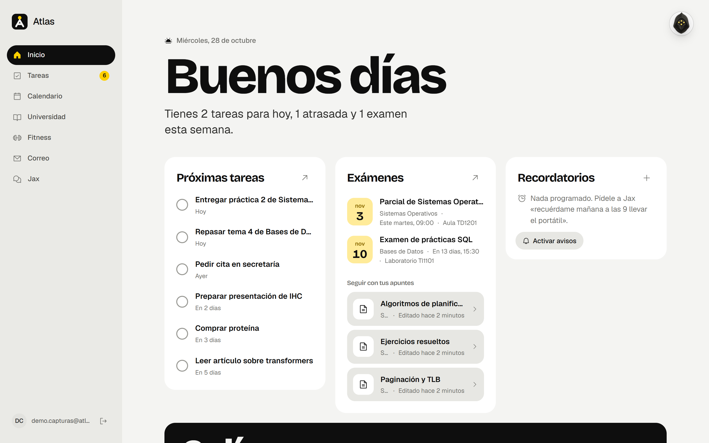
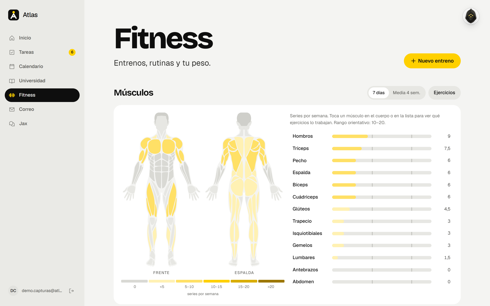
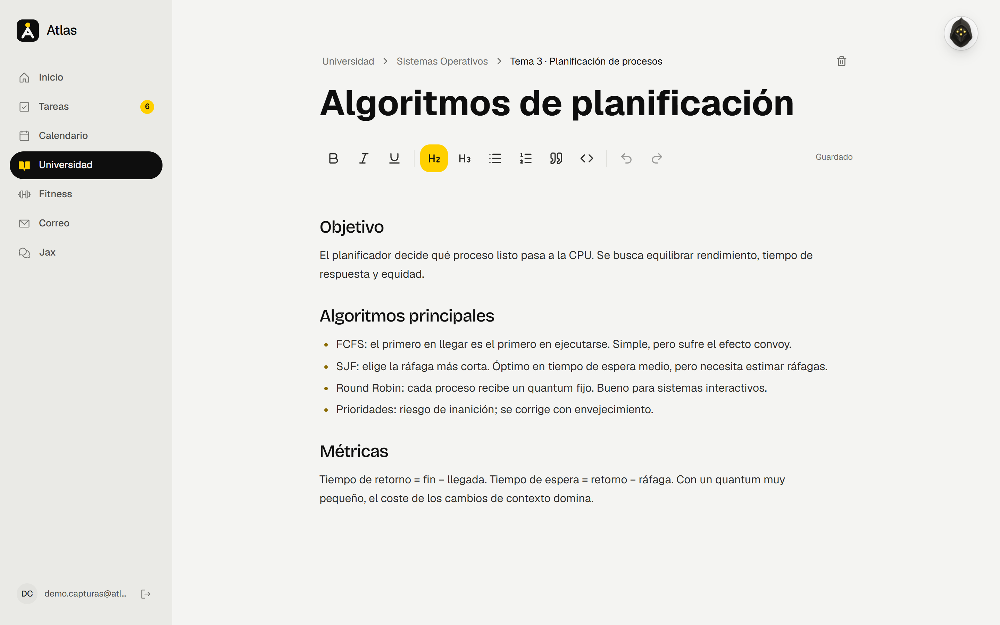
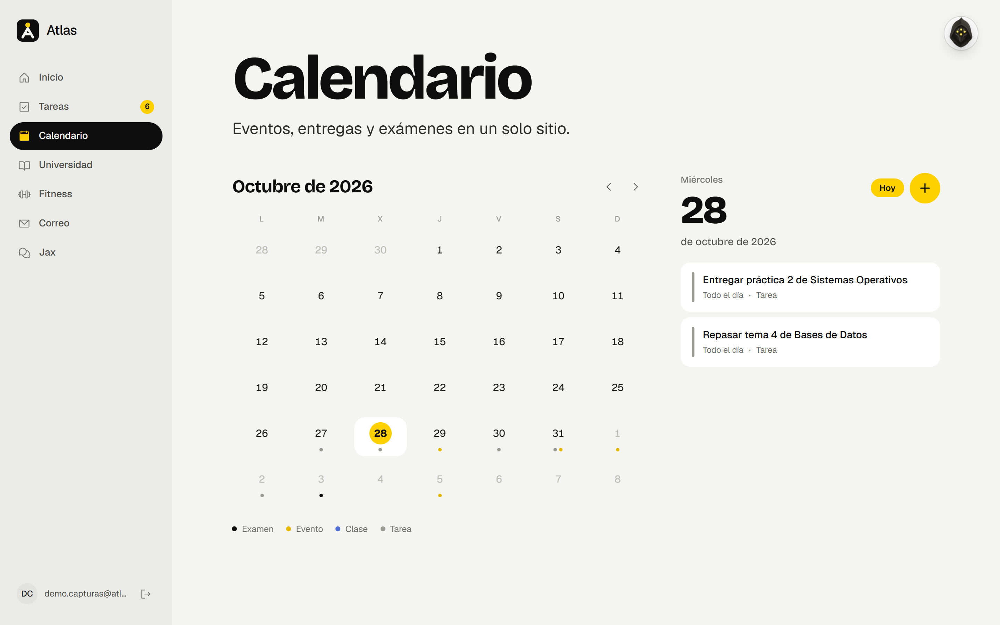
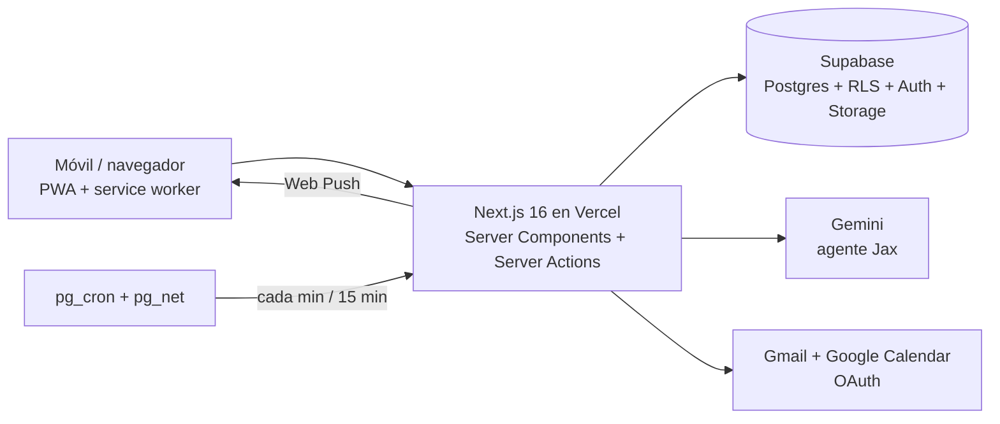

# Atlas

**Mi asistente personal: tareas, universidad, calendario, correo y gimnasio en una sola app, con un agente de IA (Jax) que lee todo y actúa por mí.**

Lo construí para mi día a día como estudiante en la Universitat Jaume I y lo uso a diario desde el móvil como PWA instalable.

[**Demo en vivo →**](https://atlas-rouge-five.vercel.app) · necesita registrarse con un correo




<table>
  <tr>
    <td></td>
    <td></td>
  </tr>
  <tr>
    <td align="center"><sub>Fitness: mapa muscular según las series de la semana</sub></td>
    <td align="center"><sub>Apuntes con editor enriquecido y guardado automático</sub></td>
  </tr>
  <tr>
    <td colspan="2"></td>
  </tr>
  <tr>
    <td colspan="2" align="center"><sub>Calendario con eventos, entregas y exámenes; sincronizado con Google Calendar</sub></td>
  </tr>
</table>

<sub>Capturas con una cuenta de demostración y datos de ejemplo.</sub>

---

## Qué hace

| Módulo | Qué incluye |
| --- | --- |
| **Inicio** | Resumen del día: próximas tareas, exámenes, recordatorios y propuestas sacadas del correo. |
| **Tareas** | Crear, editar, completar (con sonido y animación), filtrar y deshacer. |
| **Universidad** | Asignaturas → temas → apuntes con editor enriquecido (Tiptap) y guardado automático, archivos (PDF/DOCX) y exámenes. |
| **Calendario** | Vista de mes y agenda. Sincronización bidireccional con Google Calendar; los horarios de clase se importan en solo lectura. |
| **Correo** | Bandeja de la cuenta de la universidad (Gmail API, OAuth) con filtros de correo basura. Cada 15 min la IA extrae fechas y tareas del correo y las propone en Inicio; nunca se crean solas. |
| **Fitness** | Entrenos, rutinas y peso corporal. Mapa anatómico 2D (delante/detrás) que colorea los músculos según las series de la semana, récords con gráfica por ejercicio y análisis de Jax como entrenador. |
| **Recordatorios** | Avisos push (Web Push + service worker) aunque la app esté cerrada. |

### Jax, el agente

Un chat en streaming (SSE) con acceso a todos los módulos y **23 herramientas**: crear y mover tareas o eventos, apuntar entrenos, preparar recordatorios, buscar en los apuntes, redactar respuestas de correo y recordar datos a largo plazo.

Algunas decisiones de diseño:

- **El modelo nunca toca la base de datos.** Cada llamada a una herramienta pasa por los mismos validadores que los formularios de la app, así que Jax no puede guardar nada que yo no pudiera guardar a mano.
- **Sin IDs inventados.** El modelo ve referencias cortas (`t1`, `e1`, `s1`…) que se resuelven en el servidor; un id alucinado simplemente falla.
- **Cambios reversibles.** Lo que hace Jax se aplica al momento con un botón de *Deshacer*. Enviar un correo es la única excepción: no se puede deshacer y llega a otras personas, así que espera a que yo pulse *Enviar*.
- **Recuperación propia sobre los apuntes** (troceado + palabras clave) para responder con mis notas sin una base de datos vectorial.
- **Modelo de respaldo** automático si el principal está saturado (proveedor abstraído en `lib/jax/providers/`).

## Arquitectura



- **Seguridad por defecto:** cada tabla tiene Row Level Security, probada con **10 suites pgTAP**. El servidor consulta con el cliente del usuario, así que RLS limita cada query (incluidas las de Jax) a sus propias filas.
- **Tokens de Google cifrados** en reposo con AES-256-GCM (`lib/mail/crypto.ts`). Las claves secretas solo existen en el servidor (`server-only`).
- **Tareas en segundo plano sin servidor propio:** `pg_cron` llama a rutas `/api/cron/*` protegidas con un secreto guardado en Supabase Vault (recordatorios cada minuto, correo y calendario cada 15 minutos).
- **Dominio separado de la UI:** la lógica vive en `lib/` (funciones puras y testeables) y `components/` solo pinta.

## Stack

- **Frontend:** Next.js 16 (App Router, Cache Components), React 19, TypeScript estricto, Tailwind CSS 4, Motion, Phosphor Icons, Tiptap
- **Backend:** Server Actions y Route Handlers, Supabase (Postgres, Auth, Storage, pg_cron, Vault)
- **IA:** Google Gemini (`@google/genai`) con llamadas a herramientas y streaming
- **Integraciones:** Gmail API, Google Calendar API, Web Push (VAPID)
- **Calidad:** Vitest (164 tests), pgTAP, ESLint
- **Despliegue:** Vercel con auto-deploy desde `main`

## Diseño

Identidad propia, **Señal**: papel `#F4F4F2`, tinta `#0E0E0E` y un único acento amarillo `#FFD000`; titulares en Bricolage Grotesque y texto en Geist. Las superficies se separan por tono, sin bordes finos ni sombras en reposo. Las microinteracciones (chispas al completar, filas que salen deslizando, aviso con *Deshacer*) buscan que usarla a diario sea agradable.

## Estructura

```
app/
  (auth)/             login y registro
  (app)/              shell autenticado: inicio, tareas, universidad,
                      calendario, correo, fitness, recordatorios, jax
  api/                jax (SSE), correo, archivos, cron
components/           UI por módulo + ui/ compartido
lib/                  dominio por módulo (jax, mail, google, fitness, …)
supabase/
  migrations/         13 migraciones SQL
  tests/              tests pgTAP de RLS
tests/                Vitest
```

## Ejecutarlo en local

Requisitos: Node 20+ y un proyecto de Supabase.

```bash
npm install
cp .env.example .env.local      # rellenar las claves (ver comentarios del archivo)
npx supabase link --project-ref <project-ref>
npx supabase db push --linked
npm run dev                     # http://localhost:3000
```

Con solo Supabase funcionan tareas, universidad, calendario y fitness. Jax necesita `GEMINI_API_KEY`; correo y Google Calendar necesitan credenciales OAuth de Google Cloud.

```bash
npm test            # Vitest
npm run test:db     # pgTAP contra el proyecto enlazado (cada test en una transacción que se aborta)
npm run typecheck
npm run lint
```

---

Hecho por **Juan Mateu** · [GitHub](https://github.com/juanmateuhub)
